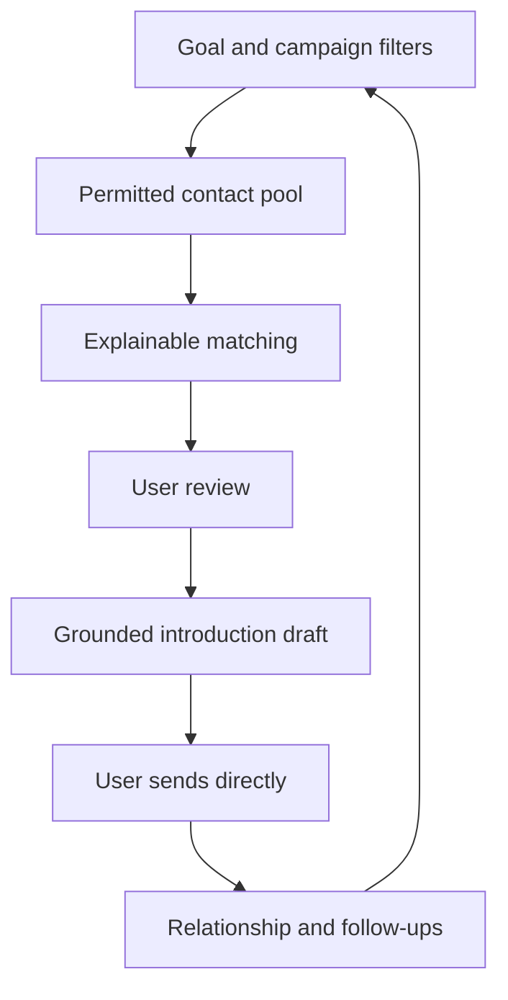

# ✦ QuickConnect

### Meet the right people. Start a real conversation.

**A professional networking assistant for finding relevant connections, preparing thoughtful introductions, and keeping relationships moving.**

[Vision](docs/PRODUCT.md) · [Architecture](docs/ARCHITECTURE.md) · [Stack](docs/STACK.md) · [Matching](docs/MATCHING.md) · [Roadmap](docs/ROADMAP.md)

---

> **“Help me build relationships with alumni working in autonomy, robotics, and aerospace.”**
>
> Turn that goal into a focused campaign, an understandable shortlist, an editable introduction, and a useful next step.

## What QuickConnect is

QuickConnect is a proposed web-first networking assistant. Users describe who they want to meet and why, filter a permitted contact pool, review the evidence behind each match, prepare an introduction, and organize the relationship after outreach.

Its central question is **“Who should I connect with, and why?”**

The product combines a campaign planner, an explainable matching system, an introduction workspace, and a lightweight relationship tracker. It should help users spend less time organizing outreach and more time having useful conversations.

**This is a documentation-only product blueprint.** The repository package describes intended behavior, proposed technology, and development gates. It contains no implemented application or passing-build claims.

## The pivot

QuickConnect began as an idea for filtered automatic connection requests. The accepted direction prioritizes relevant people, thoughtful introductions, and follow-through. Initial sending happens directly by the user in their chosen service. Automated sending is considered only through an explicitly approved integration.

It does not assume unrestricted LinkedIn search, scraping, invitation APIs, or profile access. OAuth sign-in is not permission to access every member or send invitations. Discovery requires a permitted source; an empty source pool produces an honest empty state.

## The experience

| Your goal | QuickConnect's intended help |
| --- | --- |
| Meet alumni in a field | Filter supported records by school, role, topic, company, and location |
| Find relevant hiring contacts | Distinguish recruiter role, hiring-manager evidence, explicit hiring signal, and company vacancies |
| Build research relationships | Explain topic overlap and prepare a concise specific introduction |
| Organize existing contacts | Import permitted records, review duplicates, and group them into campaigns |
| Write a first message | Draft from verified facts and user-provided goals |
| Remember the next step | Track contact status, due dates, notes, and follow-up reminders |
| Change direction | Revise a campaign without losing relationship history |

## The three daily surfaces

| Surface | What it answers |
| --- | --- |
| **Campaigns** | What network am I building, and what counts as a useful connection? |
| **People** | Who fits, what evidence supports the match, and what should I say? |
| **Follow-ups** | Who needs my attention next, and what happened last time? |

A person can belong to several campaigns while maintaining one relationship record within the user's workspace. Internal relationship notes remain private; a public code repository does not make the application's users or contacts public.

## Core principles

| Principle | Meaning |
| --- | --- |
| **Relevance before volume** | Optimize useful conversations rather than invitation counts |
| **Explain the match** | Show the criteria, evidence, missing data, and freshness |
| **Ground the introduction** | Never invent shared experiences or a person's hiring authority |
| **Respect source boundaries** | Import and search only data permitted for the intended use |
| **Keep the user in charge** | Review messages and relationship decisions |
| **Preserve continuity** | One person, multiple campaigns, clear interaction history |
| **Make uncertainty visible** | Unknown is different from false |
| **Use AI where it helps** | Core organization and filters remain usable without an AI provider |

## How it works

## Proposed stack

| Layer | Proposed direction |
| --- | --- |
| Web interface | Next.js, React, TypeScript |
| Domain logic | Typed server-side modules with explicit workspace boundaries |
| Database | PostgreSQL with structured filters and full-text search |
| Data access | Prisma candidate with reviewed migrations |
| Authentication | Established OIDC-compatible authentication solution selected in a prototype |
| AI assistance | Optional provider adapter for evidence-grounded summaries and drafts |
| Import | Previewed CSV import with mapping, provenance, and duplicate review |
| Reminders | Persisted due dates; idempotent job runner when notifications are introduced |
| Testing | Vitest, Playwright, meaningful database/isolation checks |
| Delivery | Standard web deployment; no mandatory extension or desktop runtime |

[STACK.md](docs/STACK.md) records tradeoffs. Versions are selected and tested during implementation.

## Build in evidence-backed stages

| Milestone | Result |
| --- | --- |
| **01 · Prove the data foundation** | Small permitted contact pool and a useful campaign |
| **02 · Campaigns and people** | Create goals, filter contacts, review duplicates |
| **03 · Explainable matching** | Stable ranked shortlist with evidence and uncertainty |
| **04 · Introductions** | Editable drafts grounded in the selected facts |
| **05 · Follow-through** | Relationship history, next steps, reminders |
| **06 · Pilot and release** | Private workspaces, recovery, accessible UI, measured usefulness |
| **Later · Approved integrations** | External delivery or partner sources only after access is established |

See [ROADMAP.md](docs/ROADMAP.md) for acceptance gates and estimates.

## Blueprint library

| Document | Purpose |
| --- | --- |
| [Product](docs/PRODUCT.md) | Detailed description, users, journeys, scope, and success |
| [Architecture](docs/ARCHITECTURE.md) | Runtime boundaries, flows, persistence, jobs, and recovery |
| [Technology stack](docs/STACK.md) | Component choices, alternatives, and version gates |
| [Data and sources](docs/DATA_AND_SOURCES.md) | Contact origin, permissions, freshness, and import strategy |
| [Matching](docs/MATCHING.md) | Filter semantics, ranking, evidence, and hiring signals |
| [Introductions](docs/INTRODUCTIONS.md) | Grounded drafting, editing, manual sending, and state tracking |
| [Interface](docs/UX.md) | Campaigns, people, follow-ups, onboarding, visual direction |
| [Data model](docs/DATA_MODEL.md) | Entities, ownership, identity, and lifecycle |
| [Hierarchy](docs/HIERARCHY.md) | Chief, Validator, specialists, responsibilities, and handoffs |
| [Roadmap](docs/ROADMAP.md) | Milestones, dependencies, validation, and schedule assumptions |
| [Repository plan](docs/REPOSITORY_PLAN.md) | Future layout, branches, worktrees, commits, and review |
| [Decisions](docs/DECISIONS.md) | Accepted pivot, proposals, open questions, and risks |
| [Sources](docs/SOURCES.md) | Primary technical and platform references |

## Project status

Published repository: **[EvanGUTK/Quickconnect](https://github.com/EvanGUTK/Quickconnect)**. It is public and contains this documentation-only blueprint. The planning snapshot is also available on **docs/quickconnect-product-blueprint**. No application implementation or deployment has been completed.

QuickConnect is a working brand. Name, trademark, and domain availability have not been established. No affiliation with LinkedIn, universities, or employers is implied.

**Find a reason to connect. Make the introduction count.**

