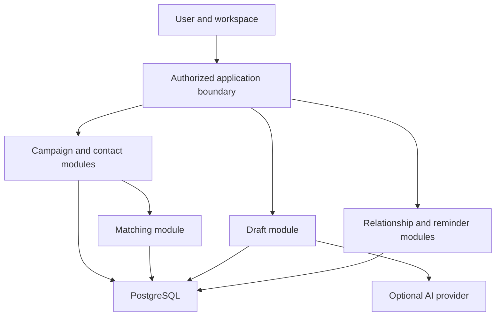

# System architecture

## Approach

Start with a modular web application and one database. Keep campaign, contact, matching, drafting, relationship, and reminder modules separate within the application. Do not introduce a service for each module before scale or deployment evidence requires it.

The browser displays workspace state and submits user actions. The server authorizes each request, validates data, executes domain logic, and persists results. Model output is treated as a draft or explanation, never authoritative contact data.

## Layers

| Layer | Responsibility |
| --- | --- |
| Presentation | Campaigns, people, follow-ups, evidence, edits, import preview |
| API/application boundary | Authentication, authorization, validation, request IDs |
| Domain modules | Campaign criteria, contact identity, matching, drafts, relationship history |
| Source adapters | Permitted input, provenance, revocation, and source-specific limitations |
| AI adapter | Grounded optional drafting/summarization with output checks |
| Persistence | Workspace-owned records, versions, facts, activity, job state |
| Job worker | Import processing or reminders only when work outgrows synchronous requests |

All application data access is scoped to an authenticated workspace. A contact ID from the browser is never sufficient authority to read a record.

## Data flow

## Import flow

Validate file type and limits, preview mappings, normalize candidate rows, preserve original source metadata, and identify duplicates. The user confirms the import mapping and conflict strategy. Commit accepted records with an import batch ID and row outcome.

An import failure must report partial results accurately. A retry must not create a second copy of successfully imported contacts. Source permissions are recorded, not inferred from a file merely being available.

CSV parsing handles encodings, quoted fields, formula-like strings, unknown columns, empty values, and row limits. Export sanitizes spreadsheet formula injection where applicable while preserving underlying text in the database.

## Matching flow

Separate required eligibility from preferred ranking. Normalize criteria, select records using permitted facts, calculate transparent contributions, and persist a result snapshot with campaign version and fact references.

The explanation is derived from the actual score inputs. An AI summary may polish wording only when it preserves the factual basis. It cannot replace missing school or hiring information.

Campaign edits and source updates create new match results. Previous snapshots can be displayed with their age; they are not mislabeled as current.

## Draft flow

Resolve the workspace-owned person and campaign. Select approved evidence and user-provided intent. Generate a template or optional provider draft. Check unsupported claims, placeholders, and requested length. Save a version that the user can edit.

A copied draft remains prepared. User-recorded “sent” is stored as a self-reported event. Future provider-confirmed delivery must be a separate event source. The first implementation does not send recipient messages.

## Relationship and reminder flow

One relationship record per person/workspace stores status and interaction history. Campaign membership adds context without duplicating the person.

Follow-ups have due time, timezone, purpose, and status. A background notification worker can retry delivery with an idempotency key. Reminder state and notification delivery are distinct so a missed email does not erase a due task.

## Permissions and private data

Authentication proves identity; every server action still enforces workspace authorization. Keep secrets server-side. Use explicit object ownership checks and test cross-workspace access paths, imports, exports, background jobs, and AI requests.

User notes and private interactions are excluded from provider requests unless needed and disclosed through the workflow. The public GitHub repository contains code/specifications and synthetic fixtures only.

## External capabilities

Adapters declare what data they can read, under what authorization, whether they can send, rate limits, freshness, and revoke/delete semantics. A provider advertising OAuth login does not automatically provide person discovery or invitations.

Disable unavailable capabilities in the UI with a reason. Do not silently replace an approved API integration with browser scraping.

## Reliability

Use version checks for concurrent edits to drafts, campaigns, and contact merges. Database transactions maintain coherent membership and identity changes. Retry only actions whose duplicate behavior is understood.

Soft deletion can help recover user errors, but explicit export/removal policy must account for derived match results, drafts, backups, and source constraints. Audit records should minimize personal data.

## Deployment

A standard web deployment and PostgreSQL database suffice initially. Add a worker only for tasks needing durable execution. The architecture must support self-hosted and hosted deployment as candidates; neither is implemented.

Backups need tested restoration and workspace ownership preservation. Schema migrations are reviewed and measured against realistic synthetic data. Search indexes are rebuildable derived state.

## Proof required

Demonstrate one campaign, one permitted import, one explained match, one grounded editable draft, and one follow-up through the actual database. Then add tests for identity ambiguity, stale facts, concurrent editing, provider outage, and cross-workspace requests.

Synthetic fixtures should prove the workflow before importing real personal data.

