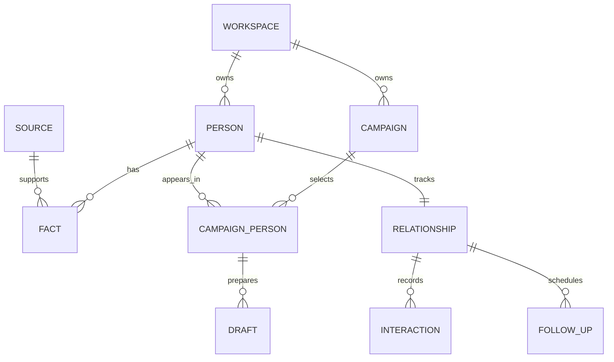

# Conceptual data model

## Status

This is a domain model proposal, not an implemented database schema. Review ownership, retention, and source terms before defining migrations.

| Entity | Main fields | Ownership/lifecycle |
| --- | --- | --- |
| User | Identity reference, preferences, timezone | Account |
| Workspace | Owner, membership, settings | Private boundary |
| Campaign | Purpose, criteria version, status | Workspace |
| Person | Internal identity, display name, merge state | Workspace |
| Fact | Field, value, normalized value, source, date, validity | Person within workspace |
| Source | Origin, permission/use metadata, freshness, access state | Workspace/source agreement |
| ImportBatch | Mapping, request ID, outcomes, status | Workspace |
| CampaignPerson | Campaign/person links, review status | Workspace |
| MatchSnapshot | Campaign version, fact refs, contributions, generation time | Derived workspace data |
| Draft | Recipient/person, purpose, channel, text, evidence refs, version | Workspace |
| Relationship | State, notes, last interaction | One per person/workspace |
| Interaction | Type, timestamp, text, provenance, campaign context | Relationship |
| FollowUp | Purpose, due time, timezone, status | Relationship/workspace |
| NotificationAttempt | Reminder ID, channel, attempt, outcome | Derived delivery data |
| ProviderConnection | Capability, protected credential reference, state | Workspace/account |

## Relationships

An implementation may use explicit IDs and constraints differently. The diagram expresses conceptual ownership, not a ready ORM mapping.

## Workspace boundaries

Every mutable/private entity is associated with a workspace. Server authorization follows that association, including derived matches, jobs, and export rows. Client-supplied workspace IDs are validated against authenticated membership.

A person can exist independently in two workspaces. Do not merge private records across users just because their names or source IDs match. A future shared directory needs a separate public entity and consent model.

## Facts versus notes

Facts carry evidence and freshness. Notes capture the user's own context. A user note can be useful for a message but must not become an externally verified fact automatically.

Keep source-backed assertions, inferred tags, and user assertions distinguishable. Ranking reads eligible facts; explanations reference the actual fact versions used.

## Identity and merge

Use stable internal IDs. Source-native IDs are attributes with source context, not globally trusted universal identity. A merge operation records candidate IDs, selected canonical person, conflict decisions, and recovery information.

Never merge solely by display name. Losing private notes or interactions during a merge is a data integrity failure.

## Versioning

Campaign criteria, drafts, and fact revisions need versions. A match snapshot references the campaign version and fact evidence. An edit does not silently overwrite the evidence behind a prior draft.

If future sending exists, approval must bind to draft version, recipient, channel, and action. The first release stores user-reported outcomes rather than delivery assertions.

## Deletion and export

Deleting a person removes or invalidates dependent drafts, membership, results, and reminders according to an explicit policy. A source withdrawal may remove source-derived facts while leaving permissible user-created relationship history.

Export describes actual state and provenance. Protect spreadsheet consumers from formula-like cells. Do not include provider credentials. Backups and recovery retention must be explained separately from active-data deletion.

## Database checks

Unique constraints for membership and relationship ownership; foreign keys for fact/source references; transactions for merge and import finalization; version checks for concurrent draft edits; indexes for workspace-scoped queries and due reminders.

Test cross-workspace authorization, duplicate imports, ambiguous merges, fact withdrawal, and reminder retries with the real selected database. Schema-looking unit tests cannot prove these properties by themselves.

