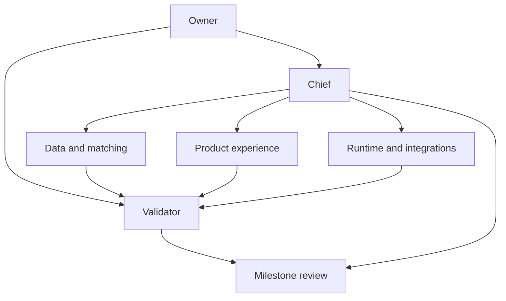

# Development hierarchy

## Purpose

The hierarchy defines responsibilities for future implementation. It does not mean a team is currently running. The owner approves milestones, the Chief plans and integrates, the Validator independently evaluates evidence, and specialists own bounded components.

Keep the team proportional to independent work. A small implementation does not require a fixed large swarm.

## Roles

| Role | Owns | Deliverable | Boundary |
| --- | --- | --- | --- |
| Owner | Purpose, scope, final product judgment | Accepted milestone plan | Review concrete behavior rather than vague effort |
| Chief | Architecture, dependencies, work packets, integration | Coherent milestone and decision record | Cannot replace independent validation |
| Validator | Acceptance evidence and relevant regression checks | Pass/block report for a specific commit | No plausible-but-untested pass |
| Product/UX | Campaigns, people, follow-ups, accessibility | Clear user flows | Do not expose implementation details unnecessarily |
| Data specialist | Provenance, import, identity, retention | Reliable permitted records | No implicit scraping/enrichment |
| Matching specialist | Criteria semantics, score contributions, explanations | Reproducible evidenced shortlist | No unsupported hiring or response predictions |
| Drafting specialist | Templates, provider grounding, draft versions | Honest editable introduction | No invented common ground |
| Backend specialist | Authorization, domain rules, transactions, jobs | Workspace-safe application logic | Client-side checks are insufficient |
| Frontend specialist | Typed interactive screens and state | Responsive usable app | Backend remains authority |
| Integration specialist | Approved sources and future delivery adapters | Capability/eligibility contract | OAuth login is not all-purpose access |
| Release specialist | Deployment, migrations, backup/restore, dependency review | Reproducible pilot | No real personal fixtures in public Git |

One implementer may cover multiple specialist roles. Chief/Validator responsibilities stay distinct for meaningful implementation reviews.

## Planning and work packets

Chief presents the goal, affected workflows, boundaries, dependency contracts, source assumptions, repository paths, acceptance scenarios, and failure cases. After the owner accepts the milestone, routine work within scope proceeds without repeated confirmation.

A packet includes goal, allowed paths, input contract, dependency commit, branch/worktree, expected output, verification, and escalation condition. Any source access assumption is explicit.

Do not assign UI and data workers incompatible interpretations of required criteria or unknown values. Agree on shared contracts first and designate a single owner for their changes.

## Validation

Specialists provide a focused commit, actual checks, and limitations. Chief evaluates fit and integration. Validator tests representative behavior independently, records the evaluated commit/environment, and blocks promotion when evidence fails.

Examples: a match explanation refers to a missing fact; a user from one workspace can access another draft; copying a message marks it sent; a duplicate import creates duplicate relationships. These failures matter more than tests that repeat the implementation's own assumptions.

A repair has a bounded scope. Recheck affected behavior after a fix and run integrated acceptance before milestone promotion.

## Model and staffing policy

Use a capable high-reasoning model for Chief and Validator when available. Specialists can use lower-cost capable models and escalate for complexity. Verify installed/account-supported names rather than hardcoding speculative provider models.

This document does not itself instruct an agent to spawn subagents. Delegation follows the owner's authorized task and actual independent work available.

## Suggested staffing by milestone

| Stage | Responsibilities |
| --- | --- |
| Data foundation | Chief, Validator, Data, Product |
| Campaigns/people | Chief, Validator, Backend, Frontend |
| Matching | Chief, Validator, Matching, Data |
| Drafting | Chief, Validator, Drafting, Product |
| Follow-ups | Chief, Validator, Backend, Frontend |
| Pilot | Chief, Validator, Release and affected owners |
| Approved integrations | Chief, Validator, Integration, Data |

## Branch/worktree rules

One isolated branch/worktree for each concurrent bounded implementation. One active owner for shared contracts. No real contact databases or credentials shared among automated test worktrees.

Atomic commits include the behavior and directly relevant tests/docs. Feature pushes produce reviewable checkpoints. Merge/release follows accepted gates and explicit owner workflow.

