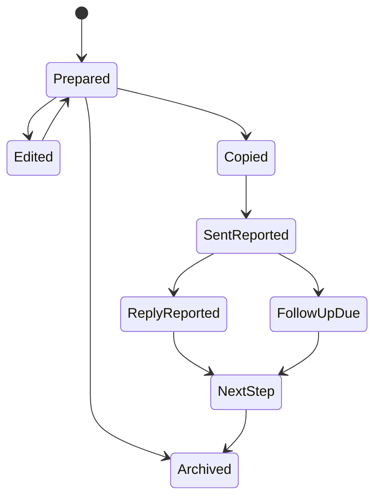

# Introduction drafting and outreach state

## Purpose

Prepare concise, specific, honest messages that the user can edit and send. The initial product improves preparation and continuity; it does not operate unauthorized invitation automation.

A good introduction states who the user is, a genuine reason for reaching out, and a small clear request when appropriate. It should avoid fabricated familiarity, unsupported praise, or promises the user has not made.

## Inputs

Use the selected campaign purpose, user-provided self-description, verified contact facts, permitted shared context, desired tone, and channel constraints. Private relationship notes are included only when the user chooses them and their use is appropriate.

Do not infer an email address, university affiliation, mutual acquaintance, hiring need, or prior meeting without evidence.

## Draft modes

| Mode | Use |
| --- | --- |
| Deterministic template | Works without AI access; fills selected verified fields |
| AI-assisted draft | Improves wording within the same factual boundaries |
| User-written draft | Stores and reviews the user's exact text |
| Follow-up draft | Uses known interaction history and the selected next step |

Templates should have meaningful structure without forcing every introduction into the same wording. Channel length limits need current verification if enforced.

## Review

Show the draft alongside its selected evidence. Flag unresolved placeholders, stale facts, unsupported assertions, and excessive length for the selected channel.

User edits create a new version. Copying or exporting a draft does not mark it sent. The user records sending explicitly in the first version. Preserve the source of that record as self-reported.

A person can receive different drafts for different campaigns, but the shared relationship history helps avoid duplicate or contradictory outreach.

## Lifecycle

These are user-recorded states. Future provider-confirmed send/delivery events must be distinguished from manual reports. A copied draft does not imply delivery, acceptance, or reply.

## Future approved delivery

If an integration is approved, expose exact recipient, content, channel, and send action before submission. Approval applies to a specific version. Changed text or target invalidates approval.

Use provider message IDs and supported idempotency where available. If acknowledgement is lost, query known state before retrying. Do not guarantee exactly-once behavior when the provider does not support it.

Automatic follow-up sequences are not part of the initial scope. A reminder prompts the user; it does not independently contact another person.

## AI boundaries

Provider output is a draft. Validate factual references and preserve source IDs. If an output claims a fact not present in the selected evidence, remove or flag it rather than storing it as a new contact fact.

Provider failure preserves the editable workspace and template fallback. Cache reusable template structure, not sensitive generated messages across users. Do not use one user's private messages as another user's examples.

## Outcomes

Track prepared, copied, user-reported sent, user-reported replied, meeting scheduled, and follow-up completed. Do not claim to know actual service delivery or connection acceptance without a supported integration.

Useful metrics include user edits, unsupported-claim flags, time to a ready introduction, and whether the user finds the draft specific and honest.

## Acceptance

Test missing facts, stale hiring evidence, school-name aliases, placeholders, changed recipients, duplicate campaign outreach, copied-but-unsent drafts, provider failure, and private-note exclusion. Synthetic examples should make it obvious whether the system invents common ground.

