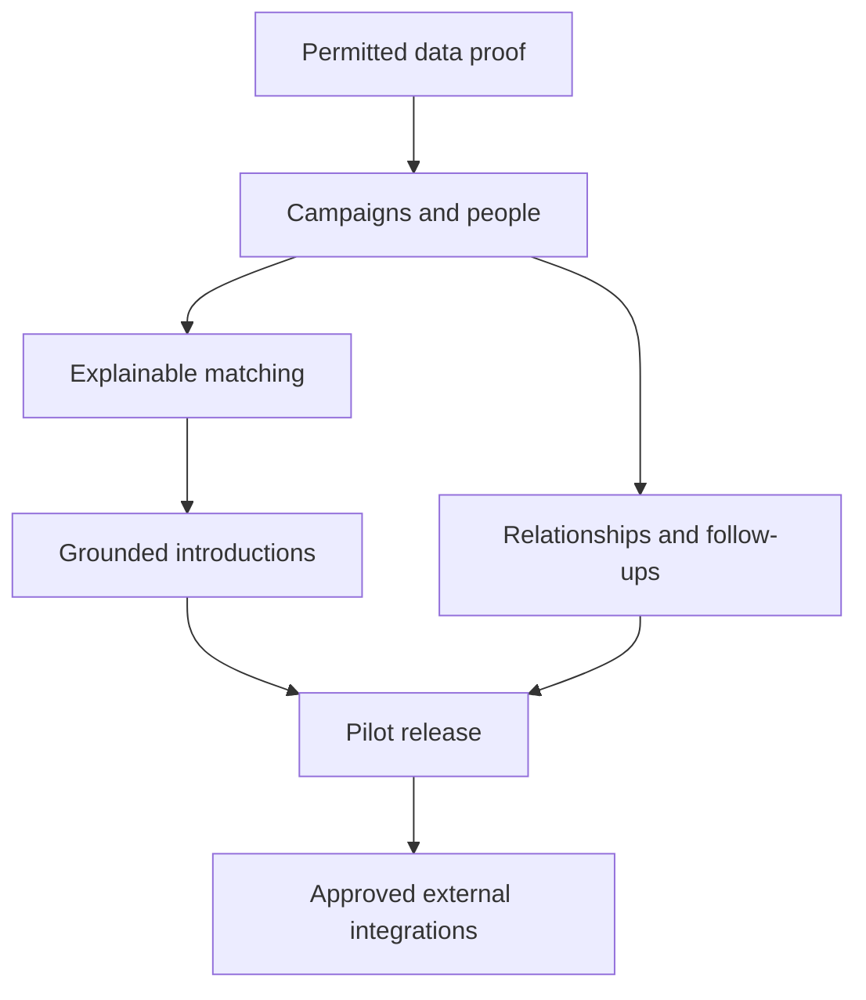

# Phased delivery plan

## Objective

Prove a useful networking workflow before adding external discovery, sending automation, an extension, or a public directory. This package is the planning deliverable; implementation begins after a milestone is accepted.

## Dependencies

## Milestone 0: Validate data and product usefulness

Select a narrow pilot audience and permitted record pool. Use synthetic fixtures first. Define the intended source use, fields, freshness, and storage constraints. Create example campaigns and evaluate whether their criteria produce useful shortlists.

Deliver a source matrix, campaign examples, identity rules, and a small end-to-end design review. Select the core stack after a minimal deployed proof.

**Acceptance:** a data pool exists with usable origin/use boundaries; users understand criteria; the product remains useful without LinkedIn access. No product plan relies on an unapproved discovery feed.

## Milestone 1: Campaigns and people

Implement authenticated private workspaces, manual records, campaign criteria, and previewed CSV import. Include conflict/duplicate review and basic person details. Persist source facts separately from private relationship notes.

**Acceptance:** create/edit/archive a campaign; import with per-row outcomes; reject malformed input; keep two same-name people separate; prevent cross-workspace reads and writes.

**Failure cases:** unknown columns, stale facts, duplicate retry, partial failure, lost response, and concurrent edits.

## Milestone 2: Explainable matching

Implement required/preferred/excluded criteria, role/school aliases, unknown handling, deterministic contributions, and versioned result snapshots. Add source-backed reasons and freshness labels.

**Acceptance:** every displayed reason maps to evidence; exclusions override ranking; unknowns cannot satisfy strict requirements; revised campaigns produce revised snapshots; company vacancies do not label every employee as hiring.

Evaluate results with a small labeled set before introducing semantic models. Do not use a polished AI paragraph to conceal weak ranking.

## Milestone 3: Introduction workspace

Implement deterministic templates, optional AI adapter, selected evidence, editable versioned drafts, copy, and explicit user-recorded sent/reply states.

**Acceptance:** no invented common ground; private notes excluded by default from provider calls; missing facts create placeholders/flags; provider outage leaves editing/templates usable; copied drafts remain unsent.

Channel-specific limits are verified before enforcement. No recipient messaging is performed in the MVP.

## Milestone 4: Relationships and follow-ups

Implement shared relationship history across campaign memberships, notes, interaction records, next steps, due dates, and an in-app follow-up view.

Add notifications only after durable idempotent job behavior is implemented. Keep reminder delivery separate from whether the user completed a follow-up.

**Acceptance:** one person in multiple campaigns has coherent history; timezone handling is correct; overdue/due/upcoming states are clear; duplicate notification retries do not create duplicate reminders.

## Milestone 5: Private pilot and release

Deploy a pilot, verify authentication/recovery, record real usability feedback with authorized data, test migrations and backup restoration, review accessibility, and measure performance on a defined workload.

**Acceptance:** all representative workflows pass; cross-workspace tests pass; public repository contains synthetic fixtures only; privacy/export/deletion behavior is explained; no unverified integration claims.

The first release's value must be demonstrable without a public directory or sending API.

## Milestone 6: Approved external integrations

Evaluate a permitted discovery/source connector or delivery connector independently. Establish eligibility, terms, scopes, fields, storage, quotas, revocation, retry semantics, and UI capability status.

**Acceptance:** access is approved and demonstrated; withdrawal/error paths work; delivery states have actual evidence; changed drafts invalidate approvals; unsupported capability stays unavailable.

An extension is considered only if it has distinct value and a permitted interaction model. It is not a shortcut around source restrictions.

## Optional later products

A consenting community directory, university/event partnerships, shared team workspaces, semantic topic matching, email/calendar synchronization, and native mobile packaging are separate increments.

Each adds data ownership and operating obligations. Do not put them into an MVP because they fit the brand story.

## Planning estimates

| Stage | Rough range for a small experienced implementation team |
| --- | --- |
| Data/product proof | 1–2 weeks |
| Campaigns, contacts, auth/import | 2–4 weeks |
| Explainable matching | 1–3 weeks |
| Draft workspace | 1–3 weeks |
| Relationships/follow-ups | 1–3 weeks |
| Pilot hardening | 2–4 weeks |

Sequential planning range: approximately 8–19 weeks before a narrow pilot. These are judgments, not commitments. Solo work, unfamiliar tooling, unavailable data, and external approvals can extend the schedule. Partner/API approval time is not included.

## Measurement proposal

| Metric | Initial pilot target |
| --- | --- |
| Unsupported claims in fixture drafts | Zero |
| Cross-workspace access failures | Zero successful unauthorized accesses |
| Required-filter mistakes | Zero in acceptance cases |
| Duplicate imports/reminders | Zero in retry acceptance cases |
| Campaign understanding | User can explain its filter logic |
| Match usefulness | User feedback on a labeled shortlist |
| Interface latency | Measure agreed workload before assigning a release target |
| Outcome usefulness | User-reported meaningful conversations, not invitation volume |

Targets are not current measured results. Do not advertise a reply-rate improvement before a suitable study.

## Evidence records

Record commit, environment, dataset origin, cases, results, failures, and remaining limitations. An empty checklist is not evidence. Test meaningful domain properties, integration failures, and access boundaries rather than mirroring code.

